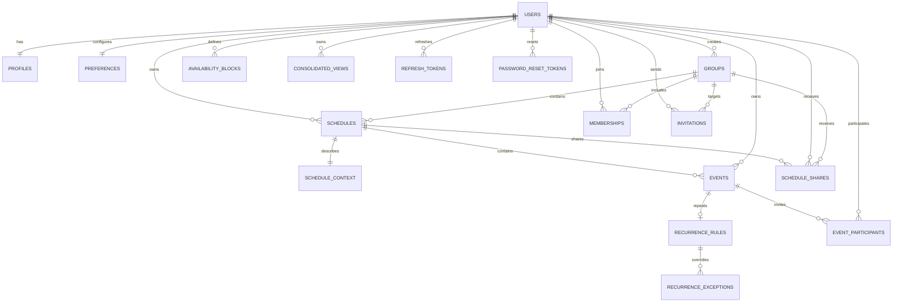

# Schedula Database Plan

**Phase:** 1 - Database plan and implementation
**Date:** 2026-10-19
**Database:** PostgreSQL 15+

## Goals and Boundaries

This schema supports a single user today while keeping ownership, sharing, and consolidated views ready for teams. Existing academic tables and seed data are intentionally replaced. Existing academic schedule JSON is not migrated because its shape is domain-specific and the target starter template has no stable generic event contract yet.

The application image and PostgreSQL image remain separate. `backend/sql/Dockerfile` packages only SQL on top of the official PostgreSQL image; the Node application connects through environment variables.

## ERD

## Design Decisions

- Every table uses a UUID primary key generated by `gen_random_uuid()`.
- Every table has `created_at`, `updated_at`, and nullable `deleted_at`. Soft deletion is the default application behavior; token and invitation cleanup may physically delete expired rows in a later maintenance job.
- Instants are stored as UTC `timestamptz`. A user/event/schedule timezone is stored separately as an IANA timezone string for display and recurrence expansion.
- Every schedule has required `owner_user_id` and nullable `group_id`. A future ownership transfer can set `group_id` and retain the original user owner without restructuring events.
- Events carry both `schedule_id` and required `owner_user_id`. This makes authorization and future ownership transfer explicit rather than inferring ownership through JSON.
- Optional event attributes are nullable and have no validation dependency: description, location, modality, category/tag, color, priority, status, recurrence rule, reminder offset, notes, and participants.
- Conflict detection uses the GiST-indexed `event_window` `tstzrange` generated from `start_at` and `end_at`. The application queries `event_window && tstzrange($start, $end, '[)')`, filters out soft-deleted rows and the current event, and applies the desired scope (same schedule, owner, group, or consolidated view). Overlaps are detected, not globally rejected, so users can intentionally keep conflicts.
- Permissions are represented by membership and share roles: group `owner/admin/member/viewer`; schedule shares `read/write/share`. The first implementation enforces these in the application service layer. PostgreSQL RLS is a future hardening option once all request paths consistently set a database user context.
- Multi-tenancy is row-scoped through owner/group/member/share foreign keys. Existing single-user rows transition by keeping `owner_user_id` populated and setting `group_id` when a group is created; no event rewrite is required.

## Table Specifications

### Identity and preferences

#### `users`

`id uuid PK`; `email citext NOT NULL UNIQUE`; `password_hash text NOT NULL`; `platform_role text NOT NULL CHECK (platform_role IN ('user','admin'))`; standard audit timestamps. `citext` provides case-insensitive identity matching.

Indexes: unique email; partial index on active users by `deleted_at`.

#### `profiles`

`id uuid PK`; `user_id uuid NOT NULL UNIQUE FK users`; `display_name text`; `timezone text NOT NULL DEFAULT 'UTC'`; `locale text NOT NULL DEFAULT 'en-US'`; `avatar_url text`; `working_hours jsonb NOT NULL DEFAULT '{}'`. Standard audit timestamps.

Indexes: unique user FK and active user lookup.

#### `preferences`

`id uuid PK`; `user_id uuid NOT NULL UNIQUE FK users`; `preferred_time_start time`; `preferred_time_end time`; `preferred_days smallint[]`; `buffer_minutes integer CHECK >= 0`; `modality_preference text CHECK (in_person/online/hybrid)`; `default_view text`; `notification_settings jsonb`; `time_of_day_preferences jsonb`; `conflict_tolerance text CHECK (strict/flexible/allow)`; standard audit timestamps.

The structured JSON fields preserve feature names that SchedulaML can consume later, including time-of-day, modality, notification intent, and conflict tolerance, without requiring a model-specific schema now.

### Scheduling core

#### `schedules`

`id uuid PK`; `owner_user_id uuid NOT NULL FK users`; `group_id uuid FK groups`; `title text NOT NULL`; `timezone text NOT NULL DEFAULT 'UTC'`; `color text`; standard audit timestamps.

Indexes: active owner, active group, and `(owner_user_id, updated_at)`.

#### `events`

`id uuid PK`; `schedule_id uuid NOT NULL FK schedules`; `owner_user_id uuid NOT NULL FK users`; `title text NOT NULL`; `start_at timestamptz NOT NULL`; `end_at timestamptz NOT NULL CHECK (end_at > start_at)`; `timezone text NOT NULL DEFAULT 'UTC'`; nullable `description`, `location`, `modality`, `category`, `color`, `priority`, `status`, `recurrence_rule`, `reminder_offset_minutes`, `notes`; generated `event_window tstzrange` with half-open `[)` bounds; standard audit timestamps.

Indexes: GiST on `event_window`; active `(schedule_id, start_at)`; active `(owner_user_id, start_at)`; schedule FK.

#### `recurrence_rules`

`id uuid PK`; `event_id uuid NOT NULL UNIQUE FK events`; `rrule text NOT NULL` containing RFC 5545 RRULE syntax; `timezone text NOT NULL DEFAULT 'UTC'`; nullable `dtstart`, `until`; standard audit timestamps.

#### `recurrence_exceptions`

`id uuid PK`; `recurrence_rule_id uuid NOT NULL FK recurrence_rules`; `occurrence_at timestamptz NOT NULL`; `is_cancelled boolean NOT NULL DEFAULT false`; `override_start_at`, `override_end_at`, `override_values jsonb`; unique `(recurrence_rule_id, occurrence_at)`; standard audit timestamps.

#### `schedule_context`

`id uuid PK`; `schedule_id uuid NOT NULL UNIQUE FK schedules`; `context jsonb NOT NULL DEFAULT '{}'`, intended for goals, constraints, tags, and other free-form schedule context; standard audit timestamps.

### Availability and participants

#### `availability_blocks`

`id uuid PK`; `user_id uuid NOT NULL FK users`; `start_at timestamptz NOT NULL`; `end_at timestamptz NOT NULL CHECK (end_at > start_at)`; `timezone text NOT NULL DEFAULT 'UTC'`; `availability_type text NOT NULL CHECK (free/busy)`; nullable `label`; standard audit timestamps. GiST index on a generated `availability_window` range plus user/time indexes.

#### `event_participants`

`id uuid PK`; `event_id uuid NOT NULL FK events`; `user_id uuid NOT NULL FK users`; `role text NOT NULL DEFAULT 'participant'`; `response_status text NOT NULL DEFAULT 'pending'`; unique `(event_id, user_id)`; standard audit timestamps.

### Future-ready collaboration

#### `groups`

`id uuid PK`; `owner_user_id uuid NOT NULL FK users`; `name text NOT NULL`; nullable `description`; standard audit timestamps.

#### `memberships`

`id uuid PK`; `group_id uuid NOT NULL FK groups`; `user_id uuid NOT NULL FK users`; `role text NOT NULL CHECK (owner/admin/member/viewer)`; unique `(group_id, user_id)`; standard audit timestamps.

#### `schedule_shares`

`id uuid PK`; `schedule_id uuid NOT NULL FK schedules`; nullable `shared_with_user_id uuid FK users`; nullable `shared_with_group_id uuid FK groups`; `permission text NOT NULL CHECK (read/write/share)`; requires exactly one recipient with a table check; standard audit timestamps; unique recipient per schedule.

#### `consolidated_views`

`id uuid PK`; `owner_user_id uuid NOT NULL FK users`; `name text NOT NULL`; `configuration jsonb NOT NULL DEFAULT '{}'` for selected schedules/members, display timezone, and conflict policy; standard audit timestamps.

#### `invitations`

`id uuid PK`; `group_id uuid NOT NULL FK groups`; `invited_by_user_id uuid NOT NULL FK users`; `email citext NOT NULL`; `role text NOT NULL CHECK (owner/admin/member/viewer)`; `token_hash text NOT NULL UNIQUE`; `expires_at timestamptz NOT NULL`; `accepted_at timestamptz`; standard audit timestamps.

### Authentication support

`refresh_tokens` has UUID `id`, `user_id`, `token_hash`, `expires_at`, `revoked_at`, and audit timestamps. `password_reset_tokens` has UUID `id`, `user_id`, `token_hash`, `expires_at`, `used_at`, and audit timestamps. Raw bearer tokens are not stored.

## Migration and Seed Strategy

Migration files are ordered and separated from rollback files:

1. `backend/sql/migrations/001_schedula_schema.up.sql` creates extensions, tables, constraints, indexes, and timestamp triggers. It is idempotent through `IF NOT EXISTS` and guarded trigger creation.
2. `backend/sql/migrations/002_demo_seed.up.sql` inserts only generic demo users, one team, memberships, schedules, context, availability, and events using deterministic email lookups and `ON CONFLICT` guards. No student, institution, course, professor, room, or academic seed data is included.
3. `001_schedula_schema.down.sql` removes the schema in dependency order for local reset/rollback.
4. `002_demo_seed.down.sql` removes only the documented demo rows.

The SQL container copies only `*.up.sql` files into PostgreSQL's initialization directory. Rollbacks remain available to operators without executing automatically during initialization. Existing databases require an intentional reset or a separately reviewed data migration; the old academic rows are not silently transformed.

## Phase 1 Implementation Notes

- The schema is implemented in `backend/sql/migrations/` and the SQL Dockerfile now copies ordered `*.up.sql` migrations.
- The old academic SQL files are removed from the initialization set.
- `backend/config/database.js` still needs the Phase 2 auth/service migration before the running API can use the new lowercase UUID schema. This is intentional and prevents Phase 1 from mixing database redesign with backend contract changes.
- The current `PRD.md` is the repository's equivalent of the turnover document's `NEW_PRD.md` reference.