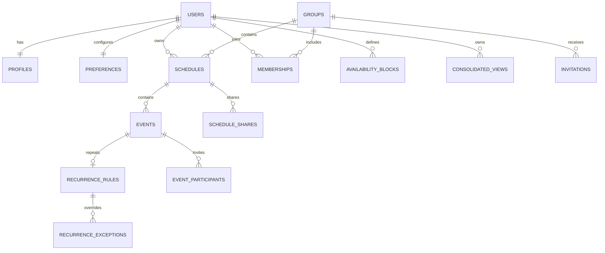

# Schedula Database Schema Architecture

This document is the compact architecture reference for the generic scheduling database. The detailed constraints and indexes are in [SCHEDULA_DB_PLAN.md](SCHEDULA_DB_PLAN.md); executable migrations are in `backend/sql/migrations/`.

## Ownership Model

## Core Tables

| Table | Purpose | Required ownership/identity |
| --- | --- | --- |
| `users` | Login identity and platform role | UUID `id`, unique case-insensitive email |
| `profiles` | Display and localization data | `user_id`, display name, timezone, locale, avatar, working hours |
| `preferences` | Scheduling preferences and SchedulaML-ready features | preferred times/days, buffer, modality, default view, notifications, time-of-day, conflict tolerance |
| `schedules` | Calendar/container | required `owner_user_id`, nullable `group_id`, title, timezone |
| `events` | Actual schedule blocks | required title, UTC `start_at`, UTC `end_at`, timezone, owner; optional generic metadata |
| `schedule_context` | Free-form schedule goals, constraints, and tags | one JSONB document per schedule |
| `recurrence_rules` | RFC 5545 recurrence definition | one rule per recurring event |
| `recurrence_exceptions` | Cancelled or overridden occurrences | occurrence timestamp and optional override values |
| `availability_blocks` | User free/busy windows | user, UTC range, timezone, free/busy type |

## Collaboration Tables

| Table | Purpose |
| --- | --- |
| `groups` | Future team container |
| `memberships` | User-to-group membership with `owner/admin/member/viewer` role |
| `schedule_shares` | Direct user/group schedule access with `read/write/share` permission |
| `event_participants` | Event invitations and response state |
| `consolidated_views` | Saved merged view configuration across schedules/members |
| `invitations` | Pending group invitations with expiry and hashed token |

## Cross-Cutting Rules

- All tables use UUID primary keys, `created_at`, `updated_at`, and nullable `deleted_at`.
- Instants use UTC `timestamptz`; timezone is stored separately for display and recurrence expansion.
- Optional event fields remain nullable: description, location, modality, category/tag, color, priority, status, recurrence, reminder offset, notes, and participants.
- Events expose a generated half-open `tstzrange` and a GiST index. Conflict queries use range overlap (`&&`) scoped to the relevant schedule, owner, group, or consolidated view.
- Soft-deleted rows are excluded by application queries and partial indexes.
- The first permission implementation is application-layer authorization. PostgreSQL RLS can be added after request-to-database user context is standardized.
- A single-user schedule is already team-ready: keep `owner_user_id`, then set `group_id` and add memberships/shares when collaboration begins.

## Migration Order

1. `001_schedula_schema.up.sql`: extensions, tables, constraints, indexes, and update timestamps.
2. `002_demo_seed.up.sql`: generic local users, one team, preferences, availability, a schedule, context, and sample events.
3. Down scripts are paired for manual rollback and are not run automatically by PostgreSQL initialization.

See [DB_UPDATE_INSTRUCTIONS.md](DB_UPDATE_INSTRUCTIONS.md) for `psql` and pgAdmin execution steps.
